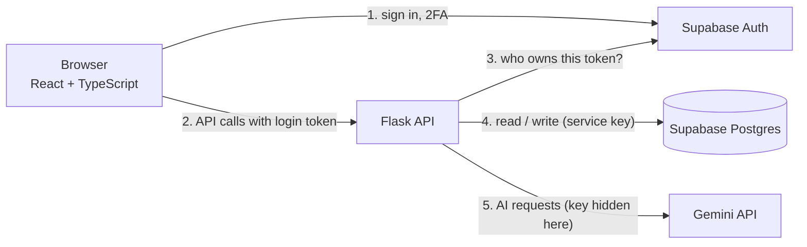

# System architecture

## The big picture



**One rule shapes everything:** the browser only talks to Supabase to sign in. All data and all AI calls go through Flask. That keeps secret keys on the server and gives you one place to validate input, check permissions, and write the audit log.

## Sign-in with 2FA

```mermaid
sequenceDiagram
  participant B as Browser
  participant S as Supabase Auth
  participant F as Flask
  B->>S: email + password
  S-->>B: token (aal1: password only)
  B->>S: 6-digit code from authenticator app
  S-->>B: new token (aal2: password + code)
  B->>F: request + token
  F->>S: is this token valid?
  S-->>F: user id, email
  F->>F: read aal claim; if 2FA required and not aal2, reject (403)
  F-->>B: data
```

`aal1` and `aal2` are "authenticator assurance levels": aal1 means one factor (password), aal2 means two (password and code).

## Request lifecycle (creating a record)

1. React calls `api('/records', {method:'POST', body})`, which attaches the token.
2. Flask `login_required` checks the token with Supabase, reads the role, and enforces 2FA if switched on.
3. `clean_record` trims input, enforces lengths, and keeps only allowed fields.
4. `db.insert_record` writes it with the service key; the owner is set from the token, never from the request body.
5. `audit.append` adds a hash-chained log entry.
6. Flask returns the record; React reloads every panel.

## Components

| Part | File | Responsibility |
|---|---|---|
| Auth state | `frontend/src/auth/AuthContext.tsx` | Session, 2FA level, sign-out |
| Route guard | `frontend/src/components/RequireAuth.tsx` | Sends users to login or 2FA when needed |
| API client | `frontend/src/lib/api.ts` | One function for every backend call, with friendly errors |
| App factory | `backend/app.py` | Routes, CORS, error handlers, input checks |
| Auth checks | `backend/auth.py` | `login_required`, `admin_required` |
| Data layer | `backend/db.py` | The only file that talks to the database |
| AI layer | `backend/ai.py` | The only file that talks to Gemini |
| Audit | `backend/audit.py` | Hash chain: append and verify |
| Helpers | `backend/utils.py` | Rate limiter and cache |

Keeping data access in `db.py` and AI access in `ai.py` means a teammate can change one without touching the rest.

## Data model

- `profiles(id, email, role)`: one row per user; role is `user` or `admin`.
- `records(id, owner, title, body, category, status, ai_summary, created_at)`: the generic "thing"; rename it for your problem.
- `audit_log(id, actor, action, entity, entity_id, payload, prev_hash, hash, ts)`: append-only history. `hash = SHA-256(prev_hash | actor | action | entity | entity_id | payload | ts)`.

## Security model

| Risk | Control | Where |
|---|---|---|
| Secret keys leak | Keys only in backend `.env`, `.env` is gitignored, frontend holds only public values | `.env.example`, `.gitignore` |
| Someone reads tables directly | Row Level Security on with no policies, so only the backend can reach data | `supabase/schema.sql` |
| Stolen or guessed password | Optional 2FA, enforced on the server, not just hidden in the UI | `auth.py`, `RequireAuth.tsx` |
| Users see each other's data | Owner checks; other people's records return "not found" | `get_owned_record` |
| Bad or oversized input | Length limits, allowed-field list, 1 MB request cap, UUID check | `clean_record`, `create_app` |
| Cross-site calls | CORS allows only listed origins | `create_app` |
| Edited history | Hash-chained audit log and a verify button | `audit.py` |
| Prompt injection | Instructions treat user text as data (reduces, does not remove, the risk) | `ai.py` |
| AI quota burned or abused | Per-user rate limit and a result cache | `utils.py`, `ai_gate` |
| Error messages leak details | Generic errors to the browser, details only in the backend log | error handlers |

## Thirty-second explanation for judges

"Users sign in with a password and an authenticator code. The browser never touches our database or our AI key: every request goes through our Flask API, which checks who you are, validates the input, and writes a hash-chained audit entry. If anyone edits history, the verify button shows exactly where the chain broke. The limits: it is tamper-evident rather than tamper-proof, and our prompt hardening reduces prompt-injection risk but doesn't remove it."

## If you had a week

Deploy behind HTTPS, move rate limiting and caching to a shared store, anchor audit hashes outside the database, add policies for per-user direct access if you want realtime features, and write end-to-end tests.
